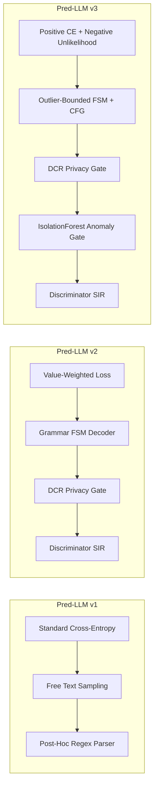

# Architectural & Mathematical Comparison: v1 vs v2 vs v3

This document compares the underlying mathematics, training objectives, decoding algorithms, and post-processing curation across the three generations of the model.

---

## 1. Mathematical Training Objectives

### Pred-LLM v1 (Paper Replication)
Uses standard autoregressive cross-entropy loss over all tokens in the linearized row sequence:
$$L_{v1}(\theta) = - \sum_{t=1}^{T} \log p_\theta(x_t \mid x_{<t})$$
* **Limitation:** Treats column names ("scaffold tokens") and actual feature values equally. On imbalanced datasets, common majority combinations dominate the gradient updates, resulting in mode collapse toward majority patterns.

---

### Pred-LLM v2 (Value-Weighted Training)
Assigns differential weights to target value tokens vs scaffold tokens:
$$L_{v2}(\theta) = - \frac{\sum_{t=1}^{T} w_t \log p_\theta(x_t \mid x_{<t})}{\sum_{t=1}^{T} w_t}$$
where $w_t = \lambda_{\text{target}}$ on target and feature value tokens, and $w_t = 0.0$ on key/scaffold tokens.
* **Benefit:** Focuses model capacity entirely on learning numerical values and category distributions rather than memorizing column names.

---

### Pred-LLM v3 (Negative Majority-Conditioned Unlikelihood Objective)
Partitions the training dataset $D$ into target minority rows $D_{\text{pos}}$ and majority contrast rows $D_{\text{neg}}$. Optimizes:
$$L_{v3}(\theta) = L_{\text{pos}}(D_{\text{pos}}) + \beta_{\text{neg}} \cdot L_{\text{unlikelihood}}(D_{\text{neg}})$$

where:
1. **Positive Cross-Entropy ($L_{\text{pos}}$):**
   $$L_{\text{pos}} = - \frac{\sum_{i \in \text{pos}} \sum_t w_t \log p_\theta(c_t \mid c_{<t})}{\sum_{i \in \text{pos}} \sum_t w_t}$$
2. **Negative Unlikelihood Penalty ($L_{\text{unlikelihood}}$):**
   $$L_{\text{unlikelihood}} = - \frac{\sum_{j \in \text{neg}} \sum_t w_t \log (1 - p_\theta(c_t \mid c_{<t}) + \epsilon)}{\sum_{j \in \text{neg}} \sum_t w_t}$$

* **Mathematical Intuition:**
  * As $p_\theta(c_t \mid c_{<t}) \to 0$ on majority rows, $-\log(1 - 0) = 0$ (no penalty).
  * If the model attempts to generate majority patterns when conditioned on a minority prompt, $-\log(1 - p) \to \infty$. This forcefully repels probability mass away from dense majority clusters.

---

## 2. Numerical Representation & Support Envelopes

### v1: MinMax Code Normalization
* Continuous features are normalized to $[0, 1]$ and mapped to fixed-precision integer strings:
  $$x_j \to \text{str}(\text{round}(x_j \cdot 10^d))$$
* **Limitation:** Loses natural numerical semantics, decimal formats, and requires post-hoc de-normalization.

### v2: Global Empirical Range
* Keeps raw units and decimals, bounding tokens to the global minimum and maximum:
  $$\text{Range}_j = [\min(x_j), \max(x_j)]$$
* **Limitation:** In skewed tables, outliers in the majority class expand the generation bounds into regions completely irrelevant to the minority class.

### v3: Outlier-Aware Support Envelopes
Computes specialized generation envelopes per numeric column $X_j$:
* **IQR Envelope (`mode='iqr'`):**
  $$\text{Range}_j = [\max(\min(x_j), Q_1 - k \cdot \text{IQR}),\; \min(\max(x_j), Q_3 + k \cdot \text{IQR})]$$
* **Minority Support Envelope (`mode='minority'`):**
  $$\text{Range}_j = [\min(x_{j, \text{minority}}),\; \max(x_{j, \text{minority}})]$$
* **Extreme Quantile Envelope (`mode='quantile'`):**
  $$\text{Range}_j = [q_{0.01}(X_j),\; q_{0.99}(X_j)]$$

---

## 3. Decoding & Inference Constraints

### v1: Unconstrained Autoregressive Sampling
* Samples tokens freely using standard top-$p$ / temperature sampling.
* If the generated string cannot be parsed into columns, it is rejected and retried up to $K$ times.
* **Failure Mode:** In small models, failure rates can exceed $20\%$, causing slow generation and missing values.

### v2: Token-Level Grammar FSM
* Enforces a Finite-State Machine (FSM) at every token step.
* Dynamically sets invalid token logits to $-\infty$, guaranteeing that candidate completions form syntactically valid numbers and categorical choices within $[\min(X_j), \max(X_j)]$.

### v3: Outlier-Bounded FSM with Classifier-Free Guidance (CFG)
* Combines the token-level FSM with active support envelope masking: only digits that maintain numbers within $\text{Range}_j$ are permitted.
* **CFG Negative Logit Guidance:** During sampling, optionally subtracts unconditioned majority logits:
  $$z_t^* = z_t(\text{prompt}) - \gamma \cdot z_t(\text{majority\_uncond})$$

---

## 4. Post-Generation Curation Pipeline

| Stage | v1 | v2 | v3 |
| :--- | :---: | :---: | :---: |
| **Stage 1: DCR Privacy Filter** | ❌ None | 🟢 Retains rows with $\text{DCR} \ge \text{Quantile}_\alpha$ | 🟢 Retains rows with $\text{DCR} \ge \text{Quantile}_\alpha$ |
| **Stage 2: Anomaly Filter** | ❌ None | ❌ None | 🟢 `IsolationForest` prunes samples that fall into the dense majority inlier cluster |
| **Stage 3: Discriminator SIR** | ❌ None | 🟢 XGBoost density-ratio resampling | 🟢 XGBoost density-ratio resampling |

---

## 5. Architectural Summary Table

